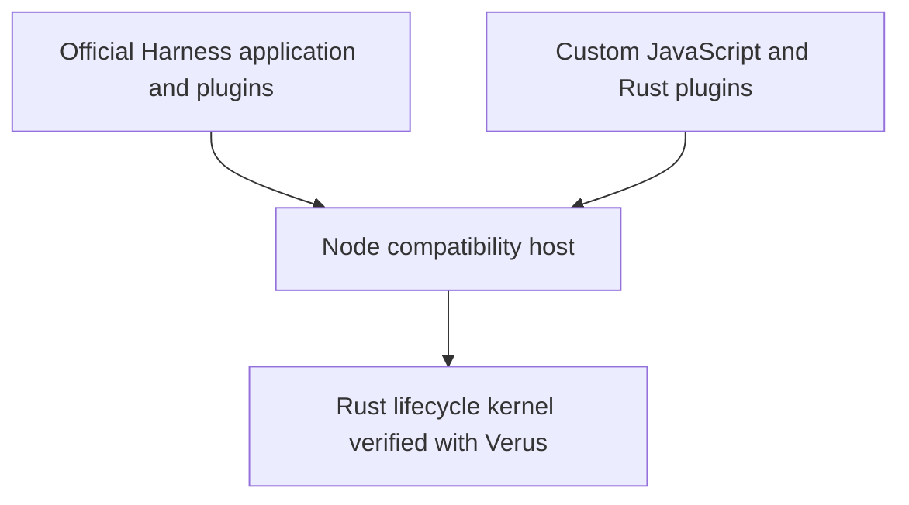

# Harness Verus

**DeepSeek Harness workflows on cordis-verus.**

[简体中文](README.zh-CN.md) · [Build guide](docs/build.md) · [Official mode](docs/official-mode.md) · [Plugin guide](docs/official-extensions.md) · [Contributing](CONTRIBUTING.md)

Run unchanged official [DeepSeek Harness](https://github.com/deepseek-ai/deepseek-harness) plugins on [cordis-verus](https://github.com/validation-engineering/cordis-verus), a Rust runtime with a Verus-verified lifecycle kernel. Use the official application, add your own plugins, and exercise the runtime in real agent workflows.

Part of [Validation Engineering](https://github.com/validation-engineering): connecting formal constraints to running code and reproducible evidence.

**Status:** Experimental, pre-1.0. The lifecycle kernel has Verus proofs; application compatibility is covered by separate behavioral and installation checks. See the [validation records](#validation-and-project-status) for the exact tested scope.

## What you can do

- **Run the official application.** Use Web or headless mode with the default `standard` composition, official Loader, settings and session storage.
- **Work through real agent and tool loops.** Use official tools, continue saved sessions, and exercise cancellation and cleanup. An offline demo uses the same official AgentLoop with a scripted model provider.
- **Compose JavaScript and Rust plugins.** Add tools and services to one lifecycle graph. Extend the official composition without replacing its agent loop or default plugins.

## Quick start

Use Node **22.22.0 or later** and npm:

```sh
npm install @validation-engineering/harness-verus
npx harness-verus
```

The npm distribution includes the prebuilt application and uses precompiled Cordis runtime packages. Starting it does not require Git, Rust, Verus or a source build. The declared native targets are Linux x64 (glibc), macOS Apple Silicon, macOS Intel and Windows x64; see [release acceptance](docs/releasing.md) for what each platform check covers.

The official CLI opens the Web application on port **3080**. Configure your model account or API key in the application, then start a session. Tools, settings, plugins and stored conversations use the official default composition. See [official mode](docs/official-mode.md) for headless usage.

Published installations keep data under `~/.harness-verus`; set `HARNESS_VERUS_HOME` to choose another location, or `DSH_HOME` for the official profile data. See the [build guide](docs/build.md) for source development.

To try the agent loop without a model account:

```sh
npx harness-verus demo
```

This secondary, compact CLI demo runs the real official loop with a **deterministic scripted provider**, making no model API request. It reads a README, writes `DEMO_RESULT.md`, completes Todo items and saves a session. It does not interpret arbitrary prompts.

From a source checkout, see what lifecycle guarantees protect in practice:

```sh
npm run demo:recovery
```

Watch a plugin update encounter a real file-cleanup failure, retain the required service, explain its blockers, recover on explicit retry, and run the new plugin through the official AgentLoop. The [recovery case](docs/recovery-case.md) includes raw diagnostics, paper-to-code review links and a portable review bundle (`npm run reproduce:recovery`) that runs without a core checkout or source compilation.

## How it works

`cordis-verus` corresponds to Cordis; this application corresponds to DeepSeek Harness. The optional `cordis-compat-deepseek` package adapts `@deepseek-ai/cordis`, while this repository owns the official application integration. See [package boundaries](docs/package-boundaries.md).



**Node is required for this application:** it hosts the existing JavaScript plugins and official CLI. The compatibility layer routes their Cordis lifecycle operations into the Rust kernel. Browser-side Cordis remains upstream JavaScript. Pure Rust applications can use the [core runtime](https://github.com/validation-engineering/cordis-verus) without Node.

The [architecture guide](docs/architecture.md) describes host responsibilities, persistence and verification boundaries.

## Extend your Harness

Plugins use the official tool API. For example, save a plugin in the application directory where you installed the package:

```js
import { defineTool } from '@validation-engineering/harness-verus/official-plugin-api';

export const name = 'hello';
export const inject = ['tools'];

export function apply(ctx) {
  ctx.tools.register(defineTool({
    name: 'hello',
    description: 'Greet a name.',
    parameters: { name: { type: 'string', required: true } },
    output: {
      schema: { type: 'string' },
      render: (_args, value) => [{ type: 'text', text: value }],
    },
    async execute(args, exec) {
      exec.signal.throwIfAborted();
      return `Hello, ${args.name}!`;
    },
  }));
}
```

Registering through the plugin's own context ties the tool's lifetime to that plugin. Follow the [extension guide](docs/official-extensions.md#loader-configuration) to load it through the official profile. That guide also explains imports for separately packaged plugins.

The existing [JavaScript greeting](examples/official/greeting.mjs) and [Rust text-analysis extension](examples/official/rust-text-analysis.mjs) demonstrate live settings and shared services. The [native module guide](docs/native-rust-modules.md) covers independently built Rust plugins and updates. Plugins run as trusted code in the host process.

## Validation and project status

The [official acceptance record](docs/official-validation-report.json) covers tested Web/headless workflows and extensions; the [compact application record](docs/validation-report.json) covers the CLI integration. Both identify their source and artifact inputs. These records describe particular snapshots and require fresh validation after input changes.

Application tests establish observed functional alignment. Formal guarantees belong to the core kernel's specified contracts and assumptions; arbitrary plugins, asynchronous host execution, external I/O and model behavior remain outside that proof scope. See the core's [paper-to-code review guide](https://github.com/validation-engineering/cordis-verus/blob/main/docs/paper-review-guide.md).

Next priorities are broader third-party plugin coverage, complete host refinement and broader platform coverage for full official workflows. See the [core roadmap](https://github.com/validation-engineering/cordis-verus/blob/main/docs/roadmap.md).

## Documentation and contributing

| Topic | Guide |
| --- | --- |
| Build and run | [Build](docs/build.md) · [Official mode](docs/official-mode.md) · [Compact CLI](docs/compact-cli.md) |
| Write plugins | [Official extensions](docs/official-extensions.md) · [Compact CLI plugins](docs/plugins.md) · [Providers](docs/providers.md) |
| Update a running application | [Native modules](docs/native-rust-modules.md) · [Loader transactions](docs/loader-transactions.md) · [Process supervision](docs/process-supervisor.md) |
| Inspect failure and recovery | [Runnable case and independent reproduction](docs/recovery-case.md) |
| Release the application | [Packaging and acceptance](docs/releasing.md) |
| Understand the implementation | [Architecture](docs/architecture.md) · [Performance notes](docs/performance.md) |

Detailed guides include English and Chinese documents. See [Contributing](CONTRIBUTING.md) for development and review expectations. Compatibility cases, plugin examples and focused fixes are welcome.

[MIT](LICENSE). Upstream licenses and attribution are preserved in [NOTICE](NOTICE) and [third-party/](third-party). This is an independent project, not an official Cordis or DeepSeek release.
