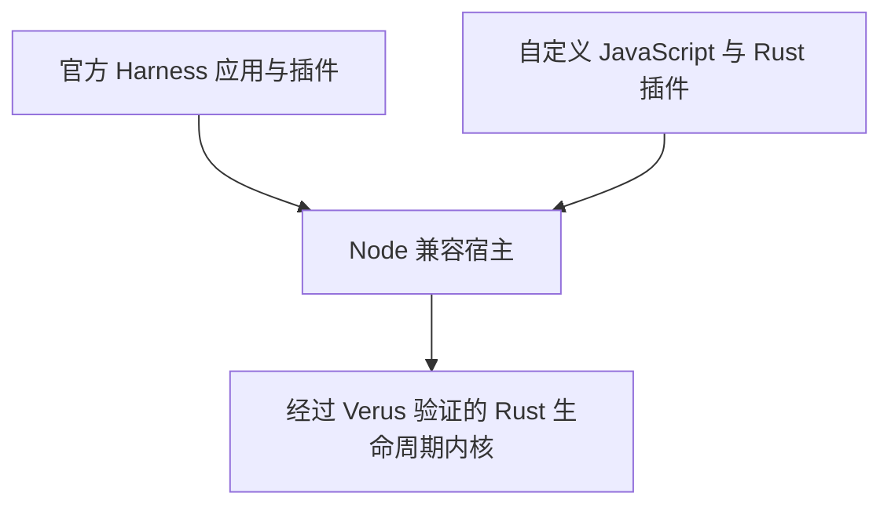

# Harness Verus

**在 cordis-verus 上运行 DeepSeek Harness 工作流。**

[English](README.md) · [构建指南](docs/build.md) · [官方模式](docs/official-mode.md) · [插件指南](docs/official-extensions.md) · [参与贡献](CONTRIBUTING.md)

在 [cordis-verus](https://github.com/validation-engineering/cordis-verus) 上运行未经修改的官方 [DeepSeek Harness](https://github.com/deepseek-ai/deepseek-harness) 插件。这个 Rust 运行时具有经过 Verus 验证的生命周期内核。使用官方应用、添加自己的插件，在真实 Agent 工作流中检验运行时。

项目属于 [Validation Engineering](https://github.com/validation-engineering)，致力于连接形式化约束、实际运行代码与可复现证据。

**状态：** 实验性、pre-1.0。本应用尚未正式发布。当前工作目录使用完成本地验收的运行时制品；验收记录注明精确源码、平台及 Node 版本。目前需要仓库访问权限。

## 可以做什么

- **运行官方应用。** 使用 Web 或 headless 模式，保留默认 `standard` 组合、官方 Loader、设置与会话存储。
- **执行真实 Agent 与工具循环。** 使用官方工具、继续已有会话，并检验取消与清理。离线演示使用同一个官方 AgentLoop，模型提供者采用脚本实现。
- **组合 JavaScript 与 Rust 插件。** 在同一生命周期图中添加工具与服务，扩展官方组合，保留原有 Agent 循环和默认插件。

## 快速开始

需要 Node **22.22.0 或更新版本**、npm 和 Git。先按[构建指南](docs/build.md)准备完成开发验收的 `../cordis-verus` 工作目录、三个运行时压缩包，以及锁定的官方 Harness 源码快照。构建这些制品需要核心项目固定的 Rust/Verus 工具链。

对于一次新的本地构建，在本仓库目录运行：

```sh
node scripts/bootstrap.mjs --cordis-source ../cordis-verus --refresh-lock --online
npm run build
npm run verify
npm run official:install
npm run official
```

官方 CLI 会打开端口 **3080** 上的 Web 应用。在应用中配置模型账号或 API key，然后开始会话。工具、设置、插件与会话存储采用官方默认组合。headless 用法见[官方模式](docs/official-mode.md)。

刷新参数会记录新构建的制品。复用已匹配的制品，或使用缓存离线安装时，请按[构建指南](docs/build.md)操作。安装完成后，运行应用不需要相邻的核心源码目录。

不配置模型账号也可以体验 Agent 循环：

```sh
npm run demo
```

这个作为辅助入口的精简 CLI 演示使用真实官方循环与**确定性脚本提供者**，不发起模型 API 请求。它读取 README、写入 `DEMO_RESULT.md`、完成 Todo 条目并保存会话。它不会理解任意自然语言提示。

想直观看到生命周期保证解决的问题，可以运行：

```sh
npm run demo:recovery
```

观察插件更新遇到真实的文件清理失败、保留所需服务、解释阻塞原因、显式重试成功，再通过官方 AgentLoop 使用新插件。[恢复案例](docs/recovery-case.zh-CN.md)提供原始诊断、论文到代码的审查路径，以及无需内核源码目录或源码编译即可运行的审查包（`npm run reproduce:recovery`）。

## 工作原理

`cordis-verus` 对应 Cordis，本应用对应 DeepSeek Harness。`cordis-compat-deepseek` 兼容包只负责 `@deepseek-ai/cordis` 接口；官方应用集成由本仓库维护。详见[包边界](docs/package-boundaries.zh-CN.md)。



**本应用需要 Node：** 它承载已有 JavaScript 插件和官方 CLI。兼容层将这些插件的 Cordis 生命周期操作导向 Rust 内核。浏览器端 Cordis 仍使用上游 JavaScript 实现。纯 Rust 应用可以直接使用[核心运行时](https://github.com/validation-engineering/cordis-verus)，无需 Node。

宿主职责、持久化与验证边界见[架构指南](docs/architecture.md)。

## 扩展 Harness

插件使用官方工具 API。例如，安装官方模式后，将以下代码保存为 `examples/official/hello.mjs`：

```js
import { defineTool } from '../../src/official-plugin-api.mjs';

export const name = 'hello';
export const inject = ['tools'];

export function apply(ctx) {
  ctx.tools.register(defineTool({
    name: 'hello',
    description: 'Greet a name.',
    parameters: { name: { type: 'string', required: true } },
    output: {
      schema: { type: 'string' },
      render: (_args, value) => [{ type: 'text', text: value }],
    },
    async execute(args, exec) {
      exec.signal.throwIfAborted();
      return `Hello, ${args.name}!`;
    },
  }));
}
```

通过插件自己的上下文注册，可以让工具的生命周期归属于该插件。按[扩展指南](docs/official-extensions.md#loader-configuration)通过官方 profile 加载它；该指南也说明了独立发布插件时的导入方式。

现有的 [JavaScript 问候插件](examples/official/greeting.mjs)与 [Rust 文本分析扩展](examples/official/rust-text-analysis.mjs)展示了动态设置与共享服务。[原生模块指南](docs/native-rust-modules.md)说明如何使用和更新独立构建的 Rust 插件。插件作为受信任代码运行在宿主进程中。

## 验证与项目状态

[官方验收记录](docs/official-validation-report.json)覆盖已测试的 Web/headless 工作流与扩展；[精简应用记录](docs/validation-report.json)覆盖 CLI 集成。两者均标识对应的源码与制品输入。这些记录描述特定快照，输入变化后需要重新验证。

应用测试检验已观察到的功能对齐。形式化保证来自核心内核在明确前提下的合同；任意插件、异步宿主执行、外部 I/O 与模型行为仍不在该证明范围内。审查路径见核心项目的[论文到代码指南](https://github.com/validation-engineering/cordis-verus/blob/main/docs/paper-review-guide.zh-CN.md)。

后续重点是扩大第三方插件覆盖、完成宿主 refinement，以及跨平台发布验收。详见[核心路线图](https://github.com/validation-engineering/cordis-verus/blob/main/docs/roadmap.md)。

## 文档与贡献

| 主题 | 指南 |
| --- | --- |
| 构建与运行 | [构建](docs/build.md) · [官方模式](docs/official-mode.md) · [精简 CLI](docs/compact-cli.md) |
| 编写插件 | [官方扩展](docs/official-extensions.md) · [精简 CLI 插件](docs/plugins.md) · [模型提供者](docs/providers.md) |
| 更新运行中的应用 | [原生模块](docs/native-rust-modules.md) · [Loader 事务](docs/loader-transactions.md) · [进程监督](docs/process-supervisor.md) |
| 检查故障与恢复 | [可运行案例与独立复现](docs/recovery-case.zh-CN.md) |
| 理解实现 | [架构](docs/architecture.md) · [性能笔记](docs/performance.md) |

详细指南包含英文和中文文档。开发与审查要求见[贡献指南](CONTRIBUTING.md)。欢迎兼容性案例、插件示例与聚焦的问题修复。

采用 [MIT](LICENSE) 许可证。上游许可证和归属声明保留在 [NOTICE](NOTICE) 与 [third-party/](third-party) 中。这是独立项目，并非 Cordis 或 DeepSeek 官方发行版。
