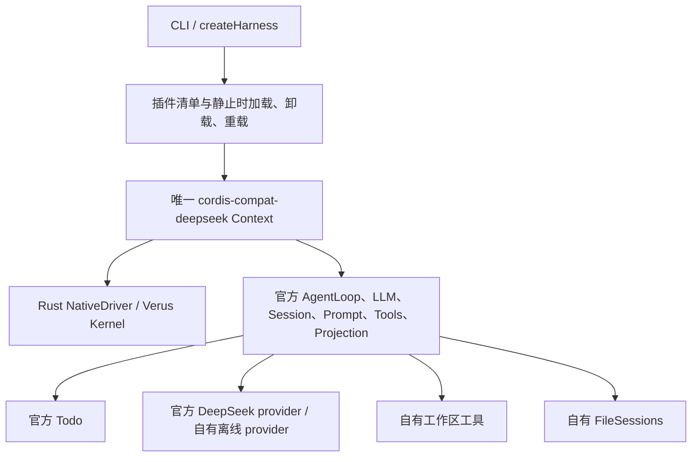

# 组合架构与边界

官方 TypeScript 源码保持原样，以锁定快照构建。`@deepseek-ai/cordis` 经 bootstrap 路由到安装在本项目的 Rust-backed profile，构建和运行都检查 Context 身份。`src/upstream.ts` 仅导出选择的官方模块，`src/app.mjs` 负责服务组合，`src/plugin-manager.mjs` 负责外部插件入口，CLI 不重写 agent loop。

## 插件与关闭

应用一次只接纳一个回合或插件变更；busy 时新的变更明确拒绝。关闭先停止新工作、取消 agent 回合，并等待已接纳的回合或插件变更实际落地，再调用官方 AgentHandle 的 disposer，最后关闭 Context。工作区插件拥有在途操作，卸载会 abort 并等待它们；实际释放失败必须上报。

插件缺依赖时报告 Pending，不伪报已激活。加载或重载失败后，只有新实例真实清理完成才可恢复旧实例。清理失败的实例仍保留在管理器，显示 `cleanupBlocked`，必须显式重试并确认清理；不会同时运行一个未经确认清理的替代者。动态 import 的缓存刷新仅覆盖本地 `.mjs` 入口，不承诺传递依赖的完整 HMR。

官方 AgentLoop 的 `whenIdle()` 表示执行落地，不代表业务成功。应用同时检查 `turn/end`、工具结果以及离线 scenario 停止状态。单次 `run` / `demo` 命令在工具失败或取消时返回非成功退出码；互动 `chat` 显示失败结果并允许继续操作。

## 会话存储

`FileSessions` 是自有插件，遵循官方 `SessionPersistence` / `SessionHandle` 合同，使用官方事件/序号/版本校验和 `agents.resume`。每个 session id 被哈希成文件名；单写者目录锁与 owner token 拒绝并发写者及被替换的所有权。写入先刷新临时文件的数据，再通过 rename 替换快照，正常读只看到完整快照。Linux/macOS 还会刷新父目录；Windows 不执行 Node 不支持的目录 fsync，因此不承诺突然断电后 rename 的目录元数据一定保留。所有平台的文件写入、文件 fsync 和 rename 错误均会向上传播，不能按“平台兼容”忽略。

append 后进程内可见，显式 flush、回合结束和正常 close 构成持久化屏障。崩溃前未 flush 的尾部可能丢失；遗留锁不会自动抢占，管理员须先确认旧进程和资源均已结束再恢复。格式不认识、事件损坏、历史倒退或锁丢失均拒绝继续，原始文件保留。永久清理失败会保留 lease；退出进程不代表外部资源已恢复。

本地快照上限 64 MiB，不是高吞吐事件数据库。未提供官方历史 JSONL/zstd 格式迁移、多机协调或持久化加密。会话可包含用户提示和工具结果，应存放在应用所属目录；文件权限采用 0600，目录采用 0700。

## 上下文容量

工具入口先限制输出：读取按 UTF-8 字节边界分页，返回路径、原始大小、offset 和 next；列表也有上限。完整文件留在工作区，可按返回范围继续读。工具 schema 在会话内保持稳定，只有用户显式改变插件组合时才变。

`limits` 在官方 `llm/stream` 之前按序列化消息与工具定义的字节数拒绝过大请求，在 `agent/request` 处限制模型步数。字节上限不是模型 tokenizer 的精确 token 预算。本轮不做有损自动摘要、不删旧事件，也不在 overflow 后无限请求另一个模型；明确失败后可缩小工具读取范围或开始新会话，原始日志仍可读取。

## 验证范围

真实官方 AgentLoop、工具、会话和 provider 参与测试；仅离线模式的模型响应是显式脚本。独立安装/路径搬迁验证排除了对研究仓库运行时路径的依赖。基础内核的证明来自所锁定 Cordis 制品的来源记录；应用测试不把 JavaScript 回调、网络服务、模型、文件系统或整个论文声明变成形式证明。
